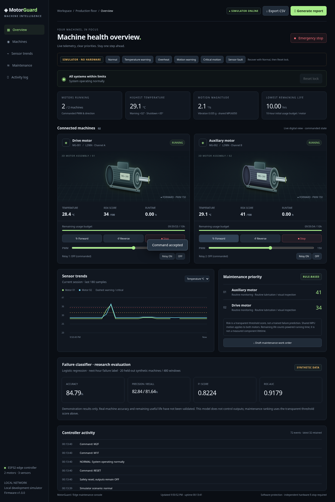

# MotorGuard — ESP32 predictive maintenance project

Offline ESP32 dashboard for **two DC motors**, two DS18B20 temperature sensors and one shared MPU6050. Includes animated CSS 3D motor assemblies, temperature/motion trends, risk ranking, persistent 10-hour usage budgets, CSV export, printable PDF reports, a maintenance work-order download, a local simulator and an evaluated demonstration classifier.



## Jaldi start karein — laptop/cloud simulator

Python 3.10+ required; simulator has **no third-party dependencies**:

```bash
cd /workspace/emergency
python3 tools/simulator.py --port 8080
```

Apne local computer par browser mein port 8080 open karein. Cloud onboarding mein loopback preview supported nahi hai; simulator requests/browser checks can run internally. Demo bar se **Normal**, **Temperature warning**, **Overheat**, **Motion warning**, **Critical motion**, aur **Sensor fault** scenarios test karein. Fault hatane ke liye **Normal → Reset lock → Forward**. Simulator real motors control nahi karta; screen clearly labels synthetic data.

**Export CSV** downloads the current browser session's latest 180 samples. **Generate report** opens the browser print dialog: choose **Save as PDF**. **Draft maintenance work order** downloads a text work order. A [sample PDF](docs/artifacts/sample-report-simulator.pdf) and [mobile screenshot](docs/artifacts/dashboard-mobile.png) are included; both use simulator data.

## ESP32 build / flash

Assumption: **classic ESP32-WROOM DevKit**, not ESP32-C3/S3 or WROVER with GPIO16/17 reserved for PSRAM. Board-specific pin compatibility must be checked before wiring.

```bash
python3 -m venv .venv
.venv/bin/pip install -r requirements-dev.txt
cp firmware/include/secrets.example.h firmware/include/secrets.h
# Edit secrets.h: set AP_SSID and a unique 8–63 character AP_PASSWORD.
PLATFORMIO_CORE_DIR="$PWD/.local/platformio" .venv/bin/pio run -j 2
PLATFORMIO_CORE_DIR="$PWD/.local/platformio" .venv/bin/pio run -t upload
PLATFORMIO_CORE_DIR="$PWD/.local/platformio" .venv/bin/pio device monitor
```

Windows: use `.venv\Scripts\` executables instead of `.venv/bin/`. PlatformIO automatically embeds `web/index.html`; no internet/CDN is needed by the ESP32 dashboard. Connect your phone to the configured AP, then use the IP printed at 115200 baud (normally `192.168.4.1`). The AP password is not logged. This cloud instance has an ignored, randomly generated build-only `secrets.h`: choose your own password before flashing.

**Verified Linux alternative (used successfully in this cloud environment):**

```bash
# After installing requirements-dev.txt and configuring secrets.h:
.venv/bin/python tools/build_arduino.py --jobs 2
# Subsequent builds can be fully offline:
.venv/bin/python tools/build_arduino.py --offline --jobs 2
```

This script downloads official Arduino CLI 1.2.2, ESP32 Arduino core 2.0.17, Xtensa GCC 8.4.0 patch5 and esptool 4.5.1 release archives, verifies their publisher SHA-256 checksums, and uses exact pinned OneWire/DallasTemperature/Ctags source commits. The lock is `tools/esp32-toolchain-lock.json`; dependencies remain in ignored `.local/`. Linux x86_64, curl, Git, make and a C compiler are required. Application output is `.local/esp32-build/MotorGuard.ino.bin`; no binary is committed because it contains your AP credential. The compile-only CLI installation reports unavailable serial/MDNS/DFU discovery helpers; compilation does not require them.

**Current verification:** full ESP32 compilation/link/image generation passes (826,545 application bytes, 63% flash; 46,492 static RAM bytes, 14%). Native firmware and simulator/browser tests pass. Direct PlatformIO registry downloads remain blocked by this cloud's policy; the verified official-release build above works without changing policy. PlatformIO users need `api.registry.platformio.org`, `dl.registry.platformio.org`, `registry.platformio.org` if restricted. Actual upload, electrical behavior and physical sensor/motor acceptance still require your board.

## Wiring

| Component | ESP32 GPIO / connection |
| --- | --- |
| DS18B20 #1 data | 16, separate 4.7kΩ pull-up to 3.3V |
| DS18B20 #2 data | 17, separate 4.7kΩ pull-up to 3.3V |
| DS18B20 power | External 3.3V VDD and common GND; parasite power unsupported |
| MPU6050 SDA / SCL | 21 / 22; address 0x68, AD0 low; 3.3V-compatible I²C |
| Relay 1 / 2 inputs | 32 / 33, active-low; use 3.3V-compatible interface |
| Motor 1 ENA / IN1 / IN2 | 25 / 26 / 27 |
| Motor 2 ENB / IN3 / IN4 | 14 / 18 / 19 |
| Active buzzer signal | 23, suitable transistor driver if current exceeds GPIO rating |
| Grounds | ESP32, sensors, driver logic and motor supply share reference ground |

Remove L298N ENA/ENB jumpers for PWM. Supply motors from a suitable external supply, never the ESP32 3.3V rail. Use pull-downs on motor enable lines and appropriate inactive pull-ups on active-low relay inputs so outputs stay safe **before firmware starts**. Match the motor supply/current to the driver, with flyback protection and fusing. GPIO25/14 PWM is an 8-bit duty command, **not measured RPM**. Relay contacts and motor movement have no feedback sensors.

## Defined behavior

| Condition | Behavior |
| --- | --- |
| All sensors valid/fresh, temperature ≤32°C | Normal; manual motor/relay commands allowed |
| Either temperature >32°C and ≤35°C | Warning on dashboard; motors continue |
| Either temperature >35°C | Immediate software shutdown on next completed reading; both motors/relays OFF, buzzer ON, lock latched |
| Vibration proxy >0.25g OR gyro magnitude >30°/s | Warning on a fresh sample; banner held for 3 seconds so brief events remain visible |
| Vibration >0.70g OR gyro >90°/s for 2 samples | Critical shutdown (~200ms at 10Hz, excluding I/O delays) |
| Severe sudden motion >1.5g proxy OR >180°/s | Shutdown on first sample |
| Missing/stale sensor with active output | Shutdown and latch; disconnected idle system cannot start |
| Emergency stop | Both motors **and relays** OFF; latch and buzzer ON |
| Reset | All sensors fresh/connected, temperatures ≤32°C, motion below warning limits, usage storage healthy; outputs stay OFF |
| Reverse command while direction is active | Rejected; explicitly Stop before changing direction |
| One motor's budget reaches zero | Critical stop; exhausted motor cannot restart, even after reset |

Both motors start OFF on every boot; no automatic resume. Critical latch/event log are in RAM and reset on power cycle; usage remains in NVS. Wi-Fi disconnection alone does not stop healthy motors: device-side monitoring continues. For a communication-loss stop, a separately specified heartbeat/watchdog policy would be needed.

MPU samples use a coherent 14-byte burst, ±2g / ±250°/s ranges, hardware low-pass filter and 10Hz software sampling. Vibration proxy is `max(abs(norm(accel)-1g), norm(accel - previous_accel))`; it includes abrupt tilts and **is not industrial RMS vibration analysis**. One shared MPU cannot identify which motor caused movement. Calibrate the demonstration thresholds on your actual installation. Sensor flags block output enable; no reset with disconnected temperature probes.

## 10-hour life-cycle counter

Each motor receives **36,000 seconds** initially. Only time with a non-STOP direction and PWM >0 is subtracted. Paused/stopped motors and PWM=0 consume no budget. Motors count independently. Usage is persisted in ESP32 NVS every 30 seconds and on stop/critical shutdown; abrupt power loss can lose up to roughly 30 seconds plus loop/I/O delay. `millis()` wraparound is handled. This measures commanded powered time, not shaft feedback or actual engineering remaining useful life.

The dashboard shows `hh:mm:ss` remaining and consumed hours. No public endpoint resets usage; after legitimate service, renewal requires a deliberate maintenance procedure/offline NVS reset. Preserve usage before erasing flash. Simulator usage is stored separately in ignored `.local/simulator-state.json`.

## Risk scoring and prediction model

Production dashboard uses an explainable advisory score:

```text
thermal = clamp((motor_temperature - 25) / 10, 0, 1) × 100
motion  = clamp(max(vibration / 0.70, rotation / 90), 0, 1) × 100
usage   = clamp(powered_runtime / 10 hours, 0, 1) × 100
risk    = max(thermal, motion, usage)
```

Scores ≥80 rank as high priority, ≥50 as inspect soon. A sensor fault gives **Unknown**, ranked first. Suggested components (cooling/load, mounting/alignment, service) are inspection hypotheses, not confirmed diagnoses.

`tools/train_model.py` supplies an actual logistic classifier, grouped 80/20 by machine identity, with training-only normalization and held-out accuracy/precision/recall/F1/ROC-AUC/confusion matrix. Default data is explicitly **synthetic demonstration data**; metrics do not establish real failure-prediction accuracy. This research model does not override firmware safety or feed unsupported predictions into the hardware dashboard.

```bash
python3 tools/train_model.py                       # reproduce synthetic evaluation
python3 tools/train_model.py --data history.csv --out .local/real-model.json
```

Historical CSV columns: `machine_id,temp_c,vibration_g,rotation_dps,used_hours,failed_next_hour`. At least 10 machines with both classes across the grouped split are required. Each row should aggregate a historical observation window with a separately observed next-hour failure label. Audit timestamps, repeated failure-window leakage and sampling bias; use a forward-time validation before deployment. [Metrics/model artifact](docs/model-metrics.json) and [project report](docs/PROJECT_REPORT.md) explain results and limitations.

## Validation

```bash
bash tools/check.sh                # Python tests + actual C++ firmware under hardware fakes + JS syntax
# With simulator already running and Chromium installed:
.venv/bin/python tools/browser_check.py
```

The C++ harness includes the actual `firmware/src/main.cpp` and verifies threshold boundaries, stale/missing sensors, stop/reset behavior, reversal rejection, strict PWM validation, per-motor time, timer rollover, exhausted budget, storage-write failure and emergency stop. Hardware fakes cannot validate Arduino/ESP-IDF binary compatibility, sensor wiring, electrical behavior or timing on a real MCU.

Browser tests exercise both motors, all simulator faults, reset lock, CSV/work-order download contents, print/PDF generation, mobile overflow and offline recovery. `docs/artifacts/` contains simulator screenshots and sample PDF. See the [hardware acceptance checklist](docs/PROJECT_REPORT.md#hardware-acceptance-checklist) before running equipment.

## Files

- `firmware/src/main.cpp` — actual ESP32 control/safety/API code.
- `web/index.html` — fully offline responsive dashboard and CSS 3D motors.
- `tools/simulator.py` — standard-library local development server with synthetic scenarios.
- `tools/train_model.py` — reproducible research classifier and held-out metrics.
- `tests/` — simulator/model tests and native tests of actual firmware.
- `platformio.ini` — pinned platform and DS18B20/OneWire dependencies (DallasTemperature tag 3.9.1, whose library metadata reports 3.9.0).

AP access grants control to devices on that network; there is no per-user login. Commands require POST and a custom header to reject ordinary cross-site form submissions; no CORS is enabled. Keep the AP private. Software shutdown and the browser button are **not certified emergency protection**. Use a physical independent emergency stop/contactor and suitable electrical protection.
