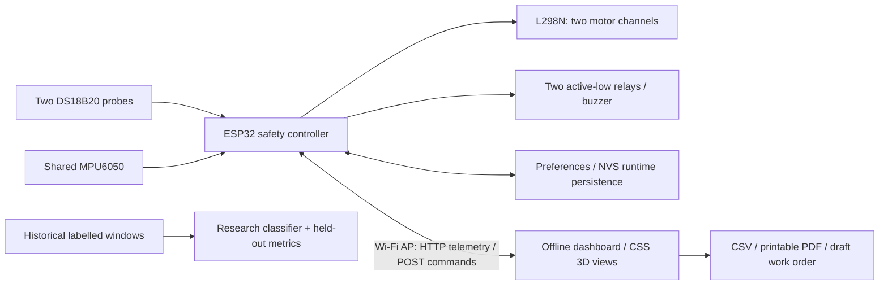

# MotorGuard project report

## Objective and delivered system

Monitor two motors, warn on elevated temperature or abrupt movement, shut down both motors and relays on critical conditions, and help prioritize maintenance. The project consists of ESP32 firmware, a completely offline web dashboard with animated 3D motor assemblies, independent usage budgets, reports, trend plots, a simulator and a research classifier.

The firmware enforces critical stops even without an open dashboard. Monitoring starts before commands are accepted. A critical lock can only be reset under safe sensor conditions; reset never restarts outputs. There is no automatic reboot resume.

## Issues corrected from the supplied sketch

| Original issue | Implemented behavior |
| --- | --- |
| Missing temperature probes treated as safe during reset | Reset requires both valid fresh temperature probes plus a fresh MPU sample |
| Stale motion values could remain after I²C read failure | Failed/stale MPU inhibits starts and trips active outputs |
| Independent register reads could span different measurements | One coherent 14-byte acceleration/temperature/gyro burst |
| Initialization write errors ignored | WHO_AM_I and every configuration write checked; periodic reconnect attempts |
| Motion counters counted evaluations, with no severe-shock path | Counters increment only for actual samples; first-sample severe-motion trip |
| Only motor stops for ALLSTOP, relays left energized | Emergency action stops all actuator outputs and latches |
| Unsafe direct reversal possible | Stop required before changing direction |
| `toInt()` silently accepted malformed PWM | Strict ASCII integer range validation before changing duty |
| GET request changed actuator state | POST + custom header; no cross-origin access headers |
| No runtime/lifecycle state | Per-motor 10-hour budget, wrap-safe accounting and NVS checkpoints |
| Dashboard could display stale animation after connection loss | Offline banner, stale-data notice, stopped 3D animation and disabled commands |
| No report/trend/priority workflow | Rolling traces, ranked risk, CSV, PDF print layout and work-order draft |
| JSON strings not escaped | API string escaping and DOM text assignment for event content |

## Temperature and motion policy

Warning >32°C; critical >35°C on either probe. An over-temperature result on one probe remains critical even if the other is disconnected. A failed sensor during an active motor/relay command causes critical shutdown. At idle, a missing sensor shows warning and blocks enables.

Motion warning >0.25g proxy or >30°/s. Firmware holds the motion warning banner for 3 seconds so a brief event remains visible between browser polls. Critical >0.70g or >90°/s for two actual 100ms samples; severe >1.5g or >180°/s trips on the first sample. The proxy captures departure from gravity and acceleration-vector changes. These are initial demonstration thresholds, not calibrated machine limits. A 10Hz sensor workflow does not resolve high-frequency bearing signatures.

Temperature conversions occur asynchronously every 1.5s with an 800ms wait. Temperature stale limit is 6s; motion stale limit is 500ms. Nominal thermal detection therefore depends on sensor conversion/cadence, not browser refresh rate. WebServer and I²C calls may block, so hard real-time bounds are not guaranteed. Independent electrical protection is required.

## Lifecycle and persistence

Each motor begins with 10h of commanded powered runtime. Usage increases only while direction is active and duty >0. Duty zero and STOP pause the budget. NVS checkpoints every 30s and on STOP/critical shutdown. Abrupt power loss can lose the latest uncheckpointed interval; this is not an exact energy or wear meter. Service exhaustion stops the system and blocks the exhausted motor's restart. Maintenance renewal is intentionally not exposed as a casual web command.

Two DS18B20 probes map respectively to motors 1/2. Shared motion is deliberately applied to both priorities; there is no basis to attribute vibration to one motor without separate sensors.

## Prediction experiment and metrics

A logistic classifier is trained with L2 regularization on four aggregated features: temperature, vibration, angular velocity and runtime. The seeded synthetic dataset contains 100 machines × 24 observation windows. Training uses 80 machine identities (1,920 windows), evaluation uses 20 unseen identities (480 windows). Normalization uses training data only. Threshold is 0.5.

**These are synthetic held-out demonstration results, not evidence of real-machine prediction performance.** Default labels come from a probabilistic simulated degradation process. The model is a research artifact, separate from the production safety/risk calculations.

| Metric | Synthetic held-out result |
| --- | ---: |
| Accuracy | 84.79% |
| Precision | 82.84% |
| Recall | 81.64% |
| F1 | 82.24% |
| ROC-AUC | 0.9179 |
| Majority-class baseline accuracy | 56.88% |
| True negative / false positive | 238 / 35 |
| False negative / true positive | 38 / 169 |

Reproduce using `python3 tools/train_model.py`; weights, scaler, split details and exact metrics are in `docs/model-metrics.json`. For real evaluation, collect timestamped failure-labelled histories, separate machines and time periods, define the failure horizon, remove overlapping-window leakage, measure class imbalance, calibrate probabilities and assess recall/false alarms prospectively. No dataset has been supplied to validate these claims on the user's machine. The 10-hour counter is a specified service budget rather than model-estimated RUL.

## Validation evidence

- 16 Python tests: simulator safety and timing, persistence, malformed requests and model-metric validation.
- Native C++ harness executes actual firmware functions using deterministic substitutes for GPIO, clock, sensors, WebServer and storage. It passes thermal-boundary, motion, stale/failing sensor, storage failure, reset, reversal, strict PWM, runtime rollover, exhausted-life and emergency-stop cases.
- Chromium integration passes both motor controls/3D states, thermal/motion/sensor fault scenarios, safe resets, download contents, print hook/PDF generation, 390px mobile width, offline recovery and no JavaScript runtime errors.
- JavaScript syntax and Git whitespace checks pass.
- Full ESP32 target compilation, linking and application/bootloader/partition image generation pass using the SHA256-verified official-release Arduino build script. Application: 826,545 bytes / 1,310,720 (63%); static RAM: 46,492 / 327,680 bytes (14%). Core 2.0.17, Xtensa GCC 8.4.0 patch5, OneWire 2.3.8 and DallasTemperature tag 3.9.1 (metadata 3.9.0). The direct PlatformIO registry route is still policy-blocked (403); `tools/build_arduino.py` is the tested Linux alternative. No board upload was performed.
- No physical board, motors, temperature probes, MPU or relays were connected for hardware acceptance. Screenshots and sample reports are explicitly simulator-based.

## Hardware acceptance checklist

1. Confirm classic ESP32-WROOM pin availability, supply voltages, GPIO-compatible relay/buzzer interfaces, pull-ups/pull-downs, common ground, motor current/driver ratings and a separate physical E-stop.
2. Set a unique AP password. Compile and flash the pinned PlatformIO target. Record board/core versions and verify serial startup with outputs OFF.
3. Initially disconnect motor power. Verify active-low relay inactive levels and zero PWM at boot, reboot, reset and controller setup failure.
4. Check both temperature readings against a reference thermometer. Warm each probe separately across 32°C and 35°C; verify warning, latch, buzzer, both driver enables zero and both relays inactive.
5. Apply calibrated controlled MPU movement: warning, two-sample critical and severe first-sample critical. Verify mounting and recalibrate thresholds to normal operating vibration. Do not use hazardous movement of live equipment as a test method.
6. Unplug each probe and MPU during a controlled low-load run. Verify active-output shutdown, reset refusal and recovery only after fresh healthy data.
7. Run motor 1 alone, then motor 2 alone at PWM >0, PWM=0 and STOP. Confirm independent countdown, saved state after restart and no automatic motor resume.
8. Test forward/stop/reverse at safe low speed; check driver temperature/current and motor coast time. A software Stop command does not prove the rotor has physically stopped before reversing.
9. Verify report exports contain the correct data source and timestamps. Record actual test observations separately from simulator evidence.
10. Validate behavior at exhausted service budget on a dedicated test board/state. Never erase production usage simply to bypass maintenance.

## Remaining limits

There is no certified safety function, actual RPM/contact feedback, per-user authentication, long-term telemetry database or validated real-machine RUL. The browser retains 180 samples in memory; controller events retain the latest 32 for the current boot. CSV is the session export. Model metrics are synthetic. These limits are explicit in the UI/docs rather than disguised as completed field validation.
